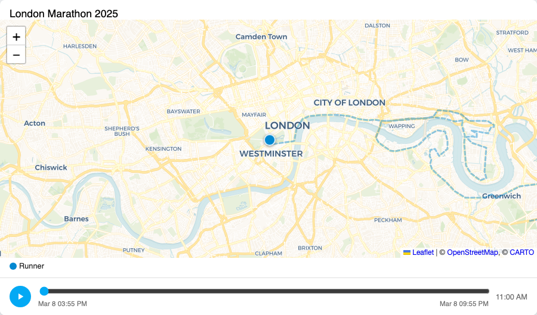

# History Map Card

[](https://github.com/custom-components/hacs)

A **Home Assistant custom Lovelace card** that extends the built-in _Map card_ with a history timeline and animated playback.

## Features

- Displays the **same base map as the built-in HA Map card** (Home Assistant 2026.10+): OpenStreetMap vector tiles rendered with MapLibre GL, served through Home Assistant's `map_tiles` proxy, with HA's own light and dark styles. Raster tiles are used when WebGL2 is unavailable, and on older Home Assistant versions (without `map_tiles`) the card falls back to OpenStreetMap raster tiles loaded directly.
- Shows the **current positions** of tracked entities.
- Draws **faded historical paths** (dashed polylines) for the configured time range.
- **Timeline bar** below the map showing the full history period.
- **Play / Pause button** – clicking Play animates entity movements across the map in chronological order, drawing markers and solid path lines as time advances.
- **Scrubbing** – drag the slider to jump to any point in history.
- During playback the slider updates in real-time to reflect the current animation position.

## Screenshot / Demo



## Installation

### Manual

1. Copy `history-map-card.js` into your Home Assistant `/config/www/` folder (create it if it doesn't exist).
2. In the **Lovelace resources** settings (Settings → Dashboards → Resources), add:
   - **URL**: `/local/history-map-card.js`
   - **Type**: JavaScript module
3. Reload the browser.

### HACS (optional)

Add this repository as a custom repository in HACS under _Frontend_.

## Configuration

Configuration is possible via UI or yaml file.

```yaml
type: custom:history-map-card
entities:
  - entity: device_tracker.my_phone
    name: My Phone          # optional, overrides friendly name
    color: "#0288d1"         # optional hex colour
  - entity: device_tracker.my_phone2
    name: My Second Phone          # optional, overrides friendly name
    color: "#d32f2f"         # optional hex colour
  - device_tracker.work_tablet  # simple string form also accepted
hours_to_show: 24            # hours of history to load (default: 24)
default_zoom: 14             # initial map zoom level (default: 14)
title: "Fleet Tracker"       # optional card title
```

### Options

| Key | Type | Default | Description |
|-----|------|---------|-------------|
| `entities` | list | **required** | List of entity IDs or objects with `entity`, `name`, `color` keys |
| `hours_to_show` | number | `24` | How many hours of history to display |
| `default_zoom` | number | `14` | Initial zoom level when only one entity is visible |
| `title` | string | — | Optional card title shown above the map |

### Entity object keys

| Key | Type | Description |
|-----|------|-------------|
| `entity` | string | Entity ID (e.g. `device_tracker.my_phone`) |
| `name` | string | Display name (overrides `friendly_name` attribute) |
| `color` | string | CSS colour for this entity's marker and path |

## Development

### Prerequisites

- Node.js ≥ 16 (recommended: ≥ 18 for latest tooling)
- npm

### Build

```bash
npm install
npm run build
# or npm run build:dev to prevent minification
# Output: history-map-card.js
```

### Tests

```bash
npm install
npm run test
npm run test:watch
npm run test:coverage
```

### Update screenshot for integration test

```
docker build --platform linux/amd64 -f Dockerfile.playwright-update -t playwright-snapshot-update . \
  && CONTAINER_ID=$(docker create playwright-snapshot-update) \
  && docker cp "$CONTAINER_ID:/app/src/test/integration/__screenshots__/marathon-map.spec.ts-snapshots/." \
       src/test/integration/__screenshots__/marathon-map.spec.ts-snapshots/ \
  && docker rm "$CONTAINER_ID"
```

### Watch mode

```bash
npm run dev
```

## How it works

1. On load the card calls `hass.callApi('GET', 'history/period/...')` with the configured entity list and time range.
2. Historical states with `latitude`/`longitude` attributes are extracted and sorted by timestamp to build a **timeline array**.
3. The slider's range maps to 0 → N-1 timeline points.
4. During **playback**, each frame advances the index by one and re-draws the accumulated path and a position marker for each entity. The delay between frames is proportional to the real elapsed time between history samples, scaled so the full animation takes approximately 30 seconds.
5. The **current real position** (from `hass.states`) is always shown as a larger marker on top.

### Base map

The base map follows the current Home Assistant frontend (`src/common/map/base-layer.ts`):

1. The card asks core for a tile access token over the WebSocket (`map_tiles/access_token`) and refreshes it every 20 minutes (core rotates it every 30).
2. With WebGL2 it loads HA's style (`/static/map/light.json` or `/static/map/dark.json`) and renders it with MapLibre GL inside Leaflet (`@maplibre/maplibre-gl-leaflet`). Tiles, glyphs and the TileJSON come from `/api/map_tiles/*` and carry the token in the `X-Map-Tiles-Token` header.
3. Without WebGL2, or after the WebGL context is lost, it uses `/api/map_tiles/raster/{z}/{x}/{y}.png?token=…`.
4. If the token request fails (Home Assistant older than 2026.10), it loads `https://tile.openstreetmap.org/{z}/{x}/{y}.png` directly.

The MapLibre worker is embedded in `history-map-card.js`, so the card is still a single file (about 1.7 MB, about 480 kB gzipped).

## License

MIT

## Node Requirements

- This project builds with Node.js 16 and above, but some newer tooling (Rollup v4, terser plugins) require Node ≥18 or Node ≥20. If you see engine warnings like `EBADENGINE` or packages that require `node >=20`, upgrade your local Node.js before running `npm install` or `npm run build`.

Recommended upgrade steps (using `nvm`):

```bash
nvm install 18
nvm use 18
npm install
```

If you cannot upgrade Node on your machine, the repository includes a minimal compatible setup (Rollup v3) and does not require the newer terser plugin; in that case `npm install` should complete without engine warnings.
